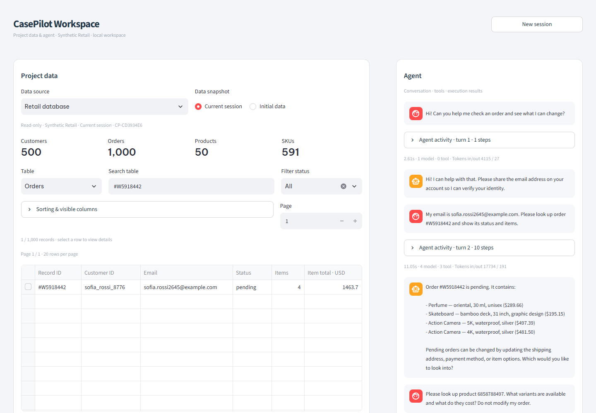
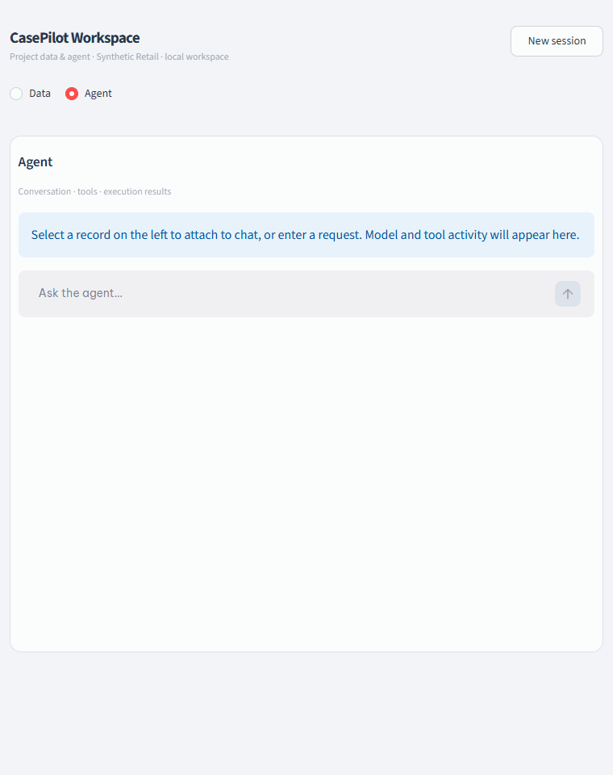

# CasePilot

An AI customer support workspace for Retail. Browse customer and order data, chat with an agent,
inspect its tool calls, and approve changes before they run.

Built with **Streamlit, LangGraph and LangChain**, using the **tau2 Retail backend**.
The interface is English; agent replies follow the user's language. Data is synthetic and resets
with each new session.



## What it can do

| Case | Example request |
| --- | --- |
| Check orders | "Show my order status and items." |
| Cancel pending orders | "Cancel this order; I no longer need it." |
| Update pending orders | "Change the shipping address on my order." |
| Return or exchange items | "Can I exchange this delivered item for another size?" |
| Inspect products | "Which variants are available, and what do they cost?" |

The agent verifies the customer and order ownership, reads current backend data, and requests
confirmation before applying changes. Eligibility follows Retail policy and order state.
The activity panel shows model calls, verification steps and tool results.

## Quick start

Requires **Python 3.12** and **uv**. Run from the project root.

### 1. Install

```powershell
python scripts/bootstrap_retail.py
uv sync --locked
```

### 2. Configure

Create `.env` if it does not already exist:

```powershell
if (!(Test-Path .env)) { Copy-Item .env.example .env }
```

Set your provider credentials:

```dotenv
OPENAI_API_KEY=your-api-key
OPENAI_BASE_URL=
```

Set `model` in `configs/default.yaml` to a provider model with tool-calling support.
Leave `OPENAI_BASE_URL` empty for the default OpenAI endpoint, or set an OpenAI-compatible URL.
For research simulations, also configure `user_model` and `judge_model` for your provider.

### 3. Run

```powershell
uv run streamlit run dashboard/app.py --server.port 8501
```

Open **http://localhost:8501**. Select a record or enter a support request, then provide the
customer's email when asked. Chat uses the configured model API; browsing data does not.
Review any proposed change before clicking **Confirm action** or **Decline action**.
Use **New session** to reset the conversation and its synthetic data. Stop the server with `Ctrl+C`.

## Demo

A continuous conversation covering order lookup, product variants, policy, a declined address
change, a revised proposal, approval and verification of the updated order.



The recording contains 9 agent turns. It uses the English chat UI; waiting is shortened for playback.

To record another conversation, install Node.js and Microsoft Edge, keep the dashboard running,
then run in a second terminal:

```powershell
npm.cmd install --prefix .cache/recording --no-audit --no-fund playwright-core@1.64.1
node scripts/record_chat_demos.cjs --live --long
```

The recorder prints a timestamped capture folder. Convert that capture to a GIF:

```powershell
uv run python scripts/render_demo_gifs.py "results/chat-demos/<capture>" --output assets/demos/long
```

Replace `<capture>` with the printed folder name. Recording makes provider calls and approves a
shipping-address change in synthetic session data.

## Architecture

LangGraph coordinates agent decisions. LangChain handles model calls and structured tools.
Tool proposals pass identity, ownership and confirmation checks before the dispatcher executes
them. Native and MCP transports share the guarded execution path and operation journal.
The tau2 adapter supplies Retail business logic and benchmark integration.

The main chat uses a single agent, native tools and full policy. Research configurations add
multi-agent planning, policy RAG, structured memory and fault injection.

One agent step runs `observe -> decide -> verify`. The session executes an admitted tool call and
feeds its result into the next step. A change requiring approval pauses until the user decides.
The model receives tool schemas; the backend's 16 Retail tools execute through LangChain
`StructuredTool` wrappers after authorization.

| Directory | Responsibility |
| --- | --- |
| `dashboard/` | Streamlit data browser, chat and activity views |
| `casepilot/customer/` | Conversation lifecycle and confirmation handling |
| `casepilot/agents/` | LangGraph decisions, state and policy checks |
| `casepilot/tools/`, `casepilot/llm/` | Tool definitions/execution and model adapter |
| `casepilot/integration/tau2/`, `casepilot/mcp/` | Retail adapters and MCP transport |
| `casepilot/rag/`, `casepilot/memory/`, `casepilot/reliability/` | Retrieval, checkpoints, history and recovery |
| `casepilot/observability/`, `casepilot/security/` | Tracing, safeguards and red-team evaluation |

RAG retrieves policy evidence, while Retail tools read current customer/order data. Available
retrievers are BM25, dense MiniLM/FAISS, hybrid rank fusion and hybrid with cross-encoder reranking.
Structured memory is optional; semantic memory M2 is not implemented.

## Security and data

Tool execution checks input schemas, customer identity, order ownership and confirmation of the
specific action. An operation journal records outcomes so unresolved changes are stopped or
reconciled instead of blindly repeated. Secret values are scrubbed from activity previews;
LangSmith metadata export is opt-in and disabled by default.

This is a local demo with synthetic data and session-scoped state. Its identity matching is not
production authentication, and it does not provide a production store or payment-settlement service.

## Research and evaluation

Launch the separate research dashboard:

```powershell
uv run streamlit run dashboard/research_app.py --server.port 8502
```

Open **http://localhost:8502** for simulations and recorded experiment results.

To run one development task through the simulator and evaluator:

```powershell
uv run python scripts/run_casepilot.py --manifest configs/benchmark-manifest.json --config configs/default.yaml --task-id 0 --output results/manual
```

Simulation calls the configured model provider. Each run saves its configuration, schedule,
conversation, traces and evaluator results under the output directory. The benchmark manifest
pins the upstream revision, policy, tools and task splits.

Recorded verification on **2026-11-07**:

| Evaluation | Result |
| --- | --- |
| Full opt-in test suite | 284 passed, no skips |
| Frozen development tasks 0/1/2 | Rewards 1/1/1, one trial each |
| Curated Giskard checks | 18 passed, no failures or errors |
| Policy retrieval | 30 queries, 12 policy chunks, four strategies |

| Retriever | Recall@3 | Recall@5 | MRR | nDCG@5 |
| --- | ---: | ---: | ---: | ---: |
| BM25 | 0.900 | 0.933 | 0.758 | 0.795 |
| Dense | 0.933 | 0.967 | 0.893 | 0.909 |
| Hybrid | 0.900 | 0.967 | 0.817 | 0.851 |
| Hybrid + reranker | 1.000 | 1.000 | 0.944 | 0.959 |

Recall measures recovered evidence; MRR measures the first relevant result's rank; nDCG measures
ranking quality. Retrieval labels are authored and not independently adjudicated. These component
scores do not establish end-to-end task success. Three known development tasks are a regression
check, not a held-out benchmark. Generated security scans remain inconclusive; agent citation
accuracy and monetary cost remain unknown.

Historical E1–E4 experiments cover architecture, RAG, recovery and memory. They retain their original
runtime provenance and were not rerun as part of this verification. Raw evaluation artifacts are
stored locally under `results/`; that directory is excluded from version control.

## Development

```powershell
uv run pytest -q
uv run ruff check casepilot dashboard scripts tests
```

To run optional local-model and live-provider tests, including security dependencies:

```powershell
uv run --group security pytest -q --run-models --run-live
```

Run retrieval evaluation or the curated red-team suite separately:

```powershell
uv run python scripts/evaluate_retrieval.py --output results/retrieval.json
uv run --group security python scripts/run_redteam.py --live --mode curated --max-scenarios 18 --max-model-calls 40 --timeout-seconds 240
```

Local-model tests load embedding/reranker weights. Live tests and red teaming use the configured
provider and can incur API charges. Curated checks cover fixed scenarios and do not guarantee
resistance to all attacks.
